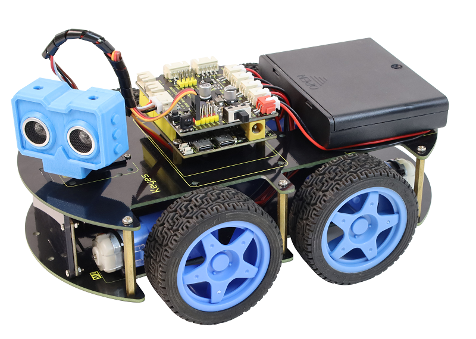

FKS0008 Keyestudio ESP32S3 4WD Smart Car
========================================

The Keyestudio FKS0008 is a 4WD smart car built around the ESP32S3 Pro
development board. It can follow a line, avoid and follow obstacles,
respond to an infrared remote control, and be driven from a phone over
Wi-Fi. An ultrasonic sensor on a servo "neck", a 5-channel line-tracking
sensor, and an 8x16 LED matrix give the car eyes, ears, and a face.

This tutorial has two parallel tracks with the same lessons:

- Arduino (C/C++ with the Arduino IDE) - Chapter 3
- MicroPython (with the Thonny IDE) - Chapter 4

Start with Chapter 1 for the product overview and packing list, then
Chapter 2 to assemble the car, and then pick either programming track.
An extended chapter at the end of each track adds AI-vision projects
(color sorting, vision line following, soccer, and a video car) using
the TinyVision camera module.

.. toctree::
   :maxdepth: 1
   :caption: ESP32S3 4WD Car

   docs/1.Introduction
   docs/2.Installation
   docs/3.Arduino/arduino
   docs/4.MicroPython/micropython
